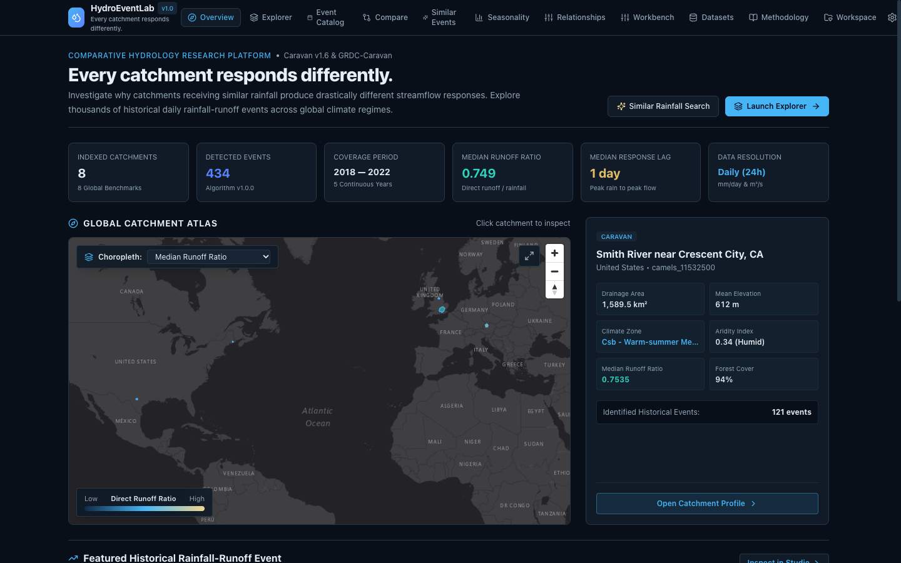
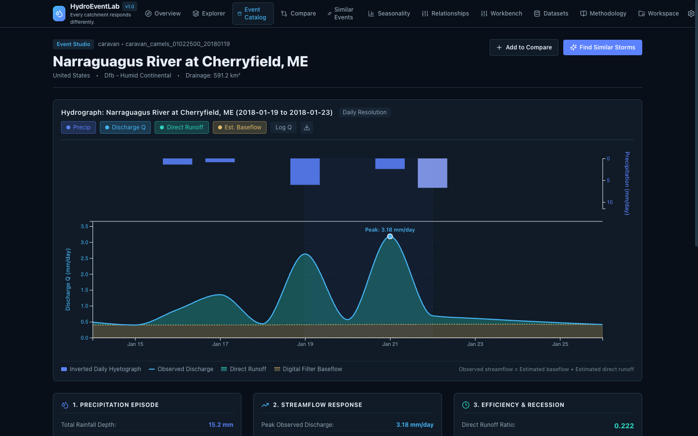
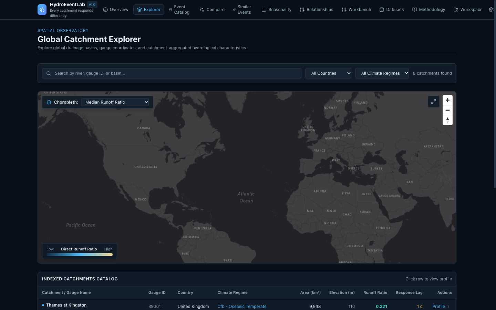
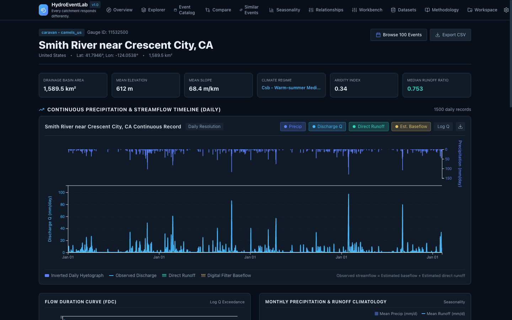
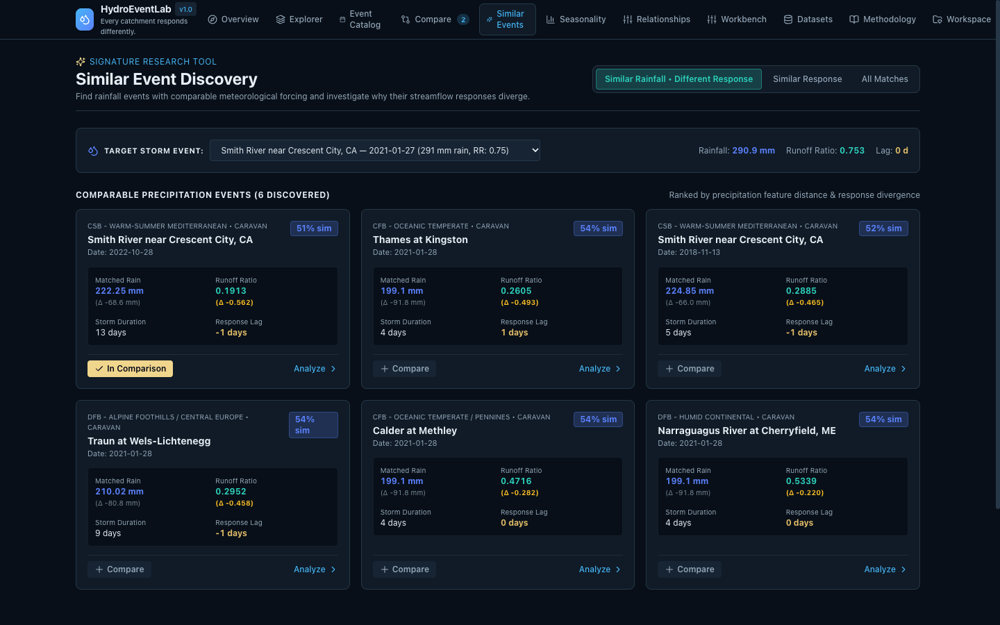
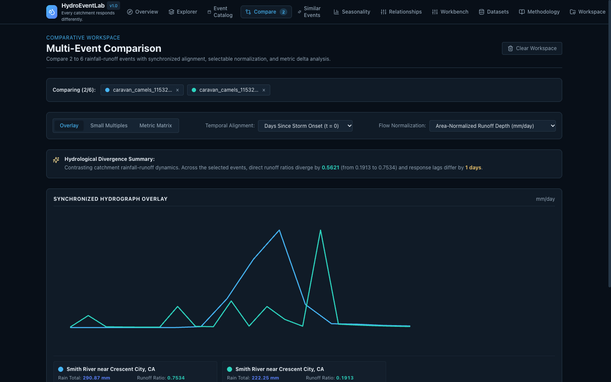
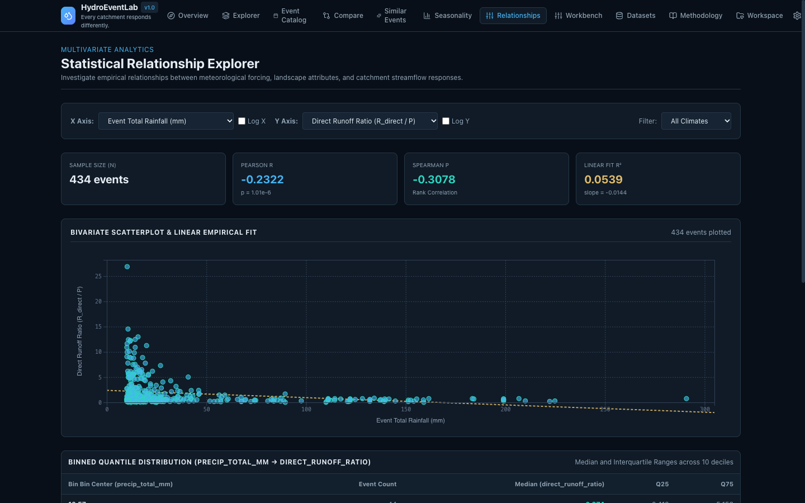
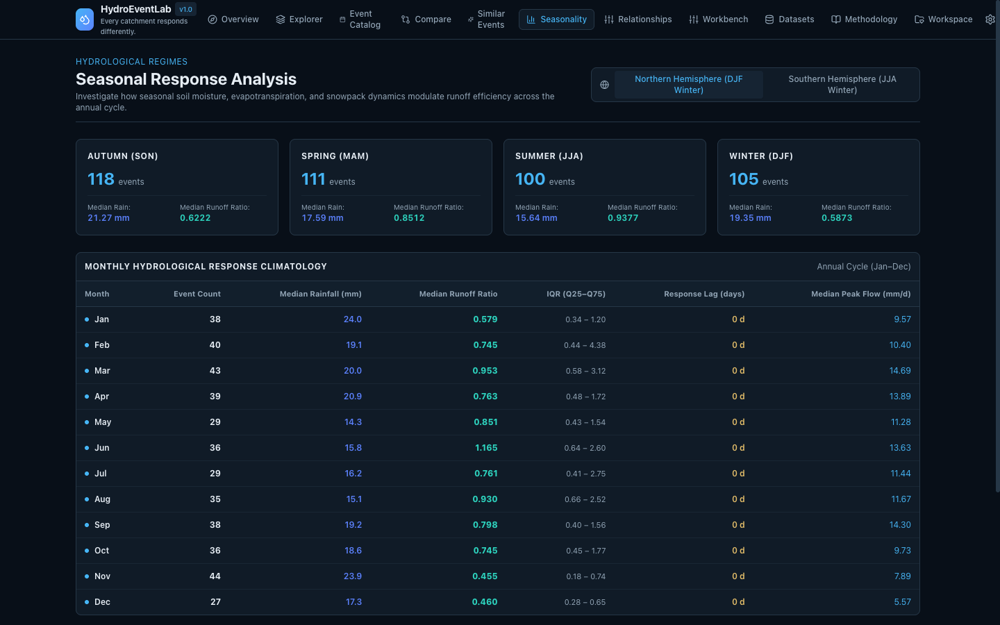
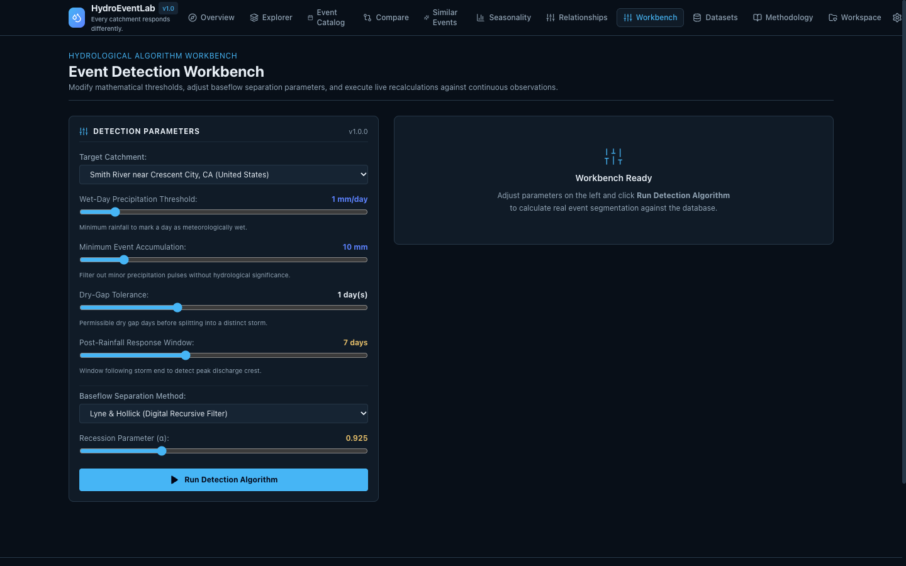

# HydroEventLab

> **Every catchment responds differently.**  
> Discover, investigate, and compare rainfall-runoff events across the world's catchments.

[](https://github.com/ranajahanzaib/hydro-event-lab/actions/workflows/ci.yml)
[](./LICENSE)
[](https://zenodo.org/records/15529786)
[](https://zenodo.org/records/15349031)



---

## 1. Scientific Overview

The central scientific question of **HydroEventLab** is:

> **Why do two catchments receiving similar rainfall produce very different streamflow responses?**

HydroEventLab is an interactive, scientific hydrological research platform engineered to explore, analyze, and compare historical daily rainfall-runoff events across the world's drainage basins. Built on the community-standardized **Caravan v1.6** and **GRDC-Caravan** datasets, it provides computational tools to investigate how landscape topography, lithology, antecedent soil moisture, and climate regimes govern catchment runoff generation.

### Scientific Capabilities

- **Global Catchment Exploration**: Interactive cartographic atlas rendering catchment boundaries, gauge locations, and environmental characteristics.
- **Configurable Event Detection Engine**: Two-stage segmentation isolating meteorological precipitation episodes from hydrological streamflow responses.
- **Hydrological Metrics Engine**: Mathematically rigorous calculation of direct runoff depth, event baseflow, runoff ratios, peak-to-peak lag, and exponential recession decay rates ($k, \tau, R^2$).
- **Continuous Baseflow Separation**: Multi-pass Lyne & Hollick (1979) digital recursive filter, Eckhardt (2005) two-parameter filter, and constant pre-event baseline.
- **Event Analysis Studio**: Publication-grade master hydrographs featuring inverted precipitation hyetographs, shaded direct runoff and baseflow areas, crosshair inspection, and SVG vector export.
- **Similar Event Discovery**: Signature _"Similar rainfall. Different response."_ search engine discovering storm events with comparable rainfall depth but contrasting streamflow responses.
- **Multi-Event Comparative Workspace**: Synchronized alignment and normalization (area-normalized $mm/day$, volumetric $m^3/s$, or normalized peak shape $Q/Q_{peak}$) across 2 to 6 historical events.
- **Multivariate Relationship Explorer**: Empirical regression, Pearson $r$, Spearman $\rho$, and binned decile distributions across catchment and event attributes.
- **Seasonal Climatology**: Annual cycle distributions and hemisphere-aware seasonal runoff efficiency analysis.

---

## 2. Visual Interface & Workflow Tour

| View                                                                                                                          | Description                                                                                                                                                                                                         |
| :---------------------------------------------------------------------------------------------------------------------------- | :------------------------------------------------------------------------------------------------------------------------------------------------------------------------------------------------------------------ |
| **Interactive Event Detail & Hydrograph**<br>         | High-precision publication-grade hydrograph plotting precipitation hyetograph (inverted), total streamflow, digital filter baseflow separation, direct runoff shading, and calibrated exponential recession curves. |
| **Global Catchment Explorer**<br>                               | Interactive MapLibre GL geospatial atlas with catchment boundary polygons, gauge markers, and configurable choropleth attributes (mean precipitation, runoff ratio, lag days).                                      |
| **Catchment Profile & Climatology**<br>                           | Multi-year continuous timeseries inspection, empirical Flow Duration Curve (FDC), and monthly regime climatology with standard deviation envelopes.                                                                 |
| **Similar Storm Discovery Engine**<br>                        | Multidimensional query engine searching catchments with comparable rainfall totals and antecedent moisture to highlight divergence in runoff generation.                                                            |
| **Multi-Event Comparative Studio**<br>                              | Normalized side-by-side hydrograph superposition with peak-to-peak alignment, volume breakdowns, and runoff ratio diagnostics.                                                                                      |
| **Multivariate Hydrological Relationships**<br> | Bivariate scatter analysis, linear regression lines, Pearson $r$, Spearman $\rho$, and binned decile distributions across catchment and event attributes.                                                           |
| **Hydrological Seasonality Regimes**<br>                      | Annual cycle heatmaps, monthly event frequency, and seasonal runoff efficiency comparisons across global climate classifications.                                                                                   |
| **Event Detection Workbench**<br>                             | Interactive parameter tuning for precipitation threshold, minimum inter-event time (MIT), and baseflow alpha filters with live event segmentation previews.                                                         |

---

## 3. Temporal Resolution & Scientific Integrity

Caravan and GRDC-Caravan provide observations aggregated at a **daily (24-hour) temporal resolution**.

HydroEventLab strictly adheres to this physical measurement interval:

- Sub-hourly rainfall intensities and flash-flood peak rates are **never** inferred from daily records.
- All response lag times and timings are reported strictly in **days**.
- Hydrographs represent discrete daily observations without artificial smoothing implying finer resolution.
- Separated baseflow is explicitly identified as an **analytical digital filter estimate**, not direct physical groundwater measurement.

---

## 4. Architecture

```
hydro-event-lab/
├── apps/
│   ├── web/               # Next.js 14 App Router, React 18, Tailwind CSS, D3.js, MapLibre GL
│   └── api/               # FastAPI backend service, Pydantic, REST endpoints
├── hydro/                 # Decoupled Scientific Hydrology Core
│   ├── baseflow/          # Lyne-Hollick, Eckhardt, Constant baseline filters
│   ├── events/            # Configurable rainfall-runoff segmentation engine
│   ├── metrics/           # Hydrological metrics, unit conversions, recession fitting
│   ├── similarity/        # Multidimensional similar storm discovery engine
│   ├── statistics/        # Bivariate regression, Pearson/Spearman, seasonal breakdowns
│   ├── spatial/           # Catchment geometry simplification and bounding boxes
│   ├── quality/           # Diagnostic flags and completeness indicators
│   ├── datasets/          # Caravan v1.6 and GRDC-Caravan schemas
│   └── ingestion/         # Ingestion pipeline and benchmark dataset generation
├── data/
│   ├── processed/         # Columnar Apache Parquet & GeoJSON analytical tables
│   └── manifests/         # Dataset catalog JSON manifests
├── scripts/               # CLI scripts for ingestion, event detection, and catalog builds
├── tests/                 # Scientific unit tests and API integration test suite
├── docs/                  # In-depth architectural and scientific documentation
└── infra/                 # Dockerfiles and deployment configurations
```

---

## 5. Quickstart

### Prerequisites

- Node.js >= 18.x
- pnpm >= 9.x
- Python >= 3.11
- uv >= 0.4.x

### Installation & Data Setup

```bash
# Clone the repository
git clone https://github.com/ranajahanzaib/hydro-event-lab.git
cd hydro-event-lab

# Install Python virtual environment and Node dependencies
make setup

# Ingest benchmark Caravan catchments, detect events, and build catalog
make rebuild-data
```

### Running Locally

```bash
# Run both Next.js frontend (port 3000) and FastAPI backend (port 8000)
make dev
```

Open [http://localhost:3000](http://localhost:3000) in your browser.  
The FastAPI interactive documentation is accessible at [http://localhost:8000/docs](http://localhost:8000/docs).

---

## 6. Automated Tests

```bash
# Run all scientific and API endpoint tests
make test

# Run scientific engine tests only
make test-hydro

# Run FastAPI tests only
make test-api

# Build Next.js web application
make build
```

---

## 7. Documentation Directory

- [Architecture & Design Principles](docs/architecture.md)
- [Dataset Specifications & Zenodo Sources](docs/datasets.md)
- [Normalized Data Models & Schemas](docs/data-model.md)
- [Data Ingestion Pipeline](docs/data-ingestion.md)
- [Event Detection Engine Workflow](docs/event-detection.md)
- [Hydrological Metrics Formulations](docs/hydrological-metrics.md)
- [Baseflow Separation Algorithms](docs/baseflow-separation.md)
- [Similar Event Discovery Engine](docs/event-similarity.md)
- [Visualization System Design](docs/visualization-system.md)
- [REST API Reference](docs/api.md)
- [Scientific Limitations & Boundaries](docs/scientific-limitations.md)
- [Data Attribution & Citation](docs/data-attribution.md)
- [Development Guide](docs/development.md)
- [Testing Suite](docs/testing.md)
- [Production Deployment](docs/deployment.md)

---

## 8. Citation

- Primary Dataset: Caravan v1.6 ([Kratzert et al., 2023](https://doi.org/10.1038/s41597-023-01975-w))
- Extension Dataset: GRDC-Caravan ([Lehner et al., 2025](https://doi.org/10.5194/essd-17-4613-2025), CC-BY 4.0)

## License & Custom Work

[](mailto:work@withrana.com) [](https://www.linkedin.com/in/workwithrana)
[](https://www.upwork.com/freelancers/~01bbcf6edb91a8df5f)
[](https://contra.com/ranajahanzaib/)

**License:** MIT, see [LICENSE](LICENSE). Free for personal and commercial use.

**Author:** Rana Jahanzaib

**Need this built for your stack?** Email me what you're working on: work@withrana.com
